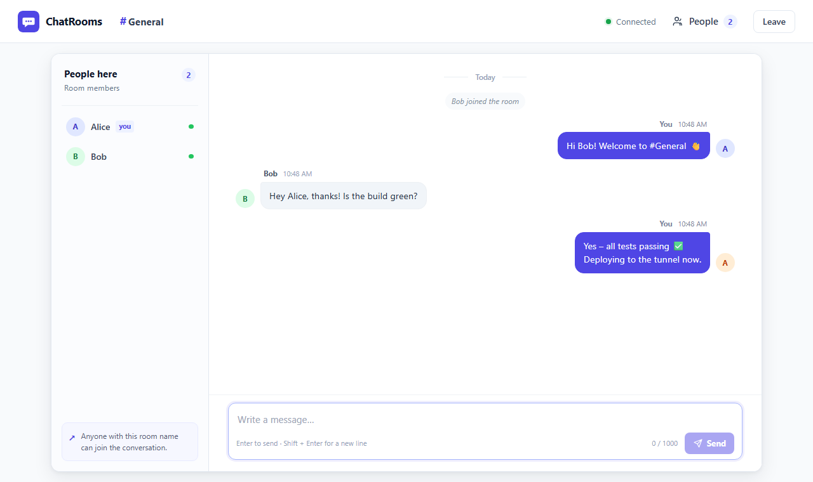
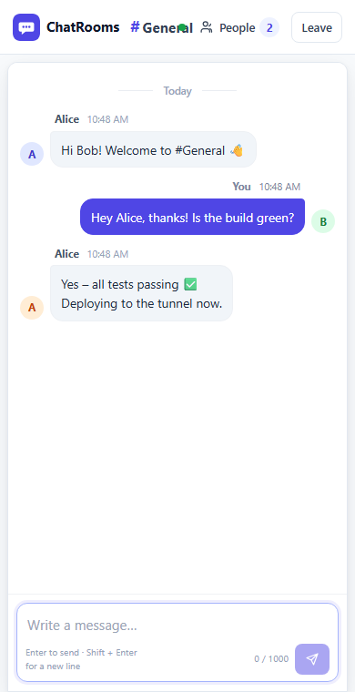

# ChatRooms – Real-Time Chat with Rooms

A real-time chat app: people enter a display name, join a room by name, and
messages (with timestamps) go out live to everyone in that room. It runs on a
laptop and can be shared over HTTPS with a Cloudflare Quick Tunnel.

Built with **Node.js**, **Express** and **Socket.IO**, with a plain HTML/CSS/JS frontend.

## Screenshots

| Login                                             | Chat room                                                  |
| ------------------------------------------------- | ---------------------------------------------------------- |
|  |  |



## Features

- Join a room with a display name; no account required
- Live room messages with server-generated timestamps shown in local time
- Online member list, join/leave notices, and automatic socket reconnection
- Room-scoped typing indicators that clear automatically after three seconds
- Unread message count in the browser tab title, reset when the chat is focused
- The latest 50 messages are available to people joining the room
- Responsive chat layout with mobile member-list toggle
- Safe text rendering: user messages are inserted as text, not HTML
- Enter to send, Shift+Enter for a newline, Unicode-aware 1000-character limit

## Architecture

```text
Browser(s) -- HTTPS / WebSocket --> Cloudflare Quick Tunnel
                                      |
                                      v
                       Express + Socket.IO on this laptop
                                      |
                                      v
                          In-memory rooms and history
```

For local use, the browser connects directly to the loopback server without a
tunnel. The server serves the frontend and `/health`; Socket.IO manages room
membership and delivers messages. The tunnel makes an outbound connection from
the laptop and forwards public HTTPS requests to the local app.

## Socket.IO events

| Direction              | Event          | Payload / acknowledgement                                                                     |
| ---------------------- | -------------- | --------------------------------------------------------------------------------------------- |
| Client → server        | `room:join`    | `{ name, room }`; acknowledges `{ ok, user, room, users, history }` or `{ ok: false, error }` |
| Client → server        | `message:send` | `{ text }`; acknowledges `{ ok: true, id }` or `{ ok: false, error }`                         |
| Client → server        | `typing`       | `{ isTyping: true/false }`                                                                    |
| Server → room          | `message:new`  | `{ id, room, name, text, ts, type: 'user' }`                                                  |
| Server → room          | `system`       | `{ id, text, ts, type: 'system' }` for join/leave notices                                     |
| Server → room          | `room:users`   | `{ users }`, the current display-name list                                                    |
| Server → other members | `typing`       | `{ name, isTyping }`                                                                          |

Timestamps are server-generated ISO 8601 strings and are displayed in each
browser's local time. Room names are case-insensitive.

## Message history

Each room keeps its latest 50 messages in memory while the server is running.
New members see those messages in chronological order. When the last member
leaves, the room and its history remain available for 10 minutes; joining again
within that period cancels the expiry. The countdown starts again when the room
next becomes empty. All history is lost when the server restarts, and anyone who
knows the room name can join and see its recent messages. Display names are not
authenticated. Message IDs are stored in the current tab for identifying your
own messages after a refresh; leaving or starting a new login clears them.

## Presence

The chat shows a typing indicator to other people in the same room while a
message is being composed. It clears when the person sends, leaves, disconnects,
or stops typing for three seconds. The browser sends one start notification per
typing burst and clears it after idle; the server also expires stale indicators.

When this tab is in the background, incoming messages from other people update
its title with an unread count, such as `(2) #general – ChatRooms`. Returning
focus to the chat clears the count. Notifications are local to the open tab and
are not persisted.

## Security and usage limits

The server applies Helmet security headers, including a Content Security Policy
that permits scripts and styles only from this app. Socket.IO accepts requests
from the same host only (or clients that omit an Origin header, such as the test
client). Each connection is limited to five messages per three seconds and ten
room joins per minute; each client IP may hold up to 20 simultaneous connections.
Socket.IO packets larger than 10 KB are rejected. The server does not log message
content.

The server binds to `127.0.0.1` by default so it is reachable only from this
laptop unless exposed through a tunnel. When behind Cloudflare Tunnel,
the app uses a valid `CF-Connecting-IP` address for connection limits and falls
back to the socket's remote address. Room names and display names are not
authentication; do not use this app for sensitive conversations.

## Prerequisites

| Tool        | Version | Install (Windows)                               |
| ----------- | ------- | ----------------------------------------------- |
| Node.js     | ≥ 20    | `winget install -e --id OpenJS.NodeJS.LTS`      |
| Git         | any     | `winget install -e --id Git.Git`                |
| cloudflared | any     | `winget install -e --id Cloudflare.cloudflared` |

> On Windows PowerShell, if `npm` is blocked by the execution policy, use `npm.cmd` instead.

## Getting started

```powershell
git clone https://github.com/logeshps02/chat_room_project_Assessment.git
cd chat_room_project_Assessment
npm ci
npm start           # http://127.0.0.1:3000
```

## Run publicly from this laptop

Install Node.js and `cloudflared` using the prerequisites above, then open
PowerShell in the project folder:

```powershell
npm.cmd ci          # first setup, or after dependencies change
npm.cmd run public
```

The command starts the app and a Cloudflare Quick Tunnel, prints a public
`https://...trycloudflare.com` link, and attempts to copy it to the clipboard.
Share that link and keep the terminal open. Press **Ctrl+C** to stop, or use a
second terminal in the project folder:

```powershell
npm.cmd run stop:public
```

The URL changes each time you start the tunnel. It works only while the laptop,
app, internet connection, and tunnel are running. Keep the laptop plugged in and
prevent it from sleeping while hosting. No router port forwarding is required.
If port 3000 is already in use, stop that server first or choose another port:

```powershell
$env:PORT = '3210'
npm.cmd run public
```

This starts a separate app instance on that port. If `npm.cmd` is not on your
PATH, reopen PowerShell after installing Node.js or run
`& 'C:\Program Files\nodejs\npm.cmd' run public`. The script also checks the
standard Windows installation folder for `cloudflared`.

Quick Tunnels have no uptime guarantee and are intended for on-demand use. For
a stable address, use a Cloudflare named tunnel with your own domain and
Cloudflare account, or an ngrok account and its configured domain. Do not share
sensitive messages: room names and display names are not passwords or identities.

### Stable-address alternatives

For a Cloudflare named tunnel, start the app locally in one terminal, then use
another terminal (replace the hostname with a domain in your Cloudflare account):

```powershell
cloudflared tunnel login
cloudflared tunnel create chatrooms
cloudflared tunnel route dns chatrooms chat.example.com
cloudflared tunnel --url http://127.0.0.1:3000 run chatrooms
```

For ngrok, install it, configure your account token privately, and run
`ngrok http 3000` against the local app. Follow ngrok's instructions to use a
reserved domain. Without the Cloudflare client-IP header, the connection limit
may apply to all visitors sharing the tunnel's local address.

## Scripts

| Command               | What it does                          |
| --------------------- | ------------------------------------- |
| `npm start`           | Start the server                      |
| `npm run dev`         | Start with auto-restart on changes    |
| `npm run public`      | Start the app and a public tunnel     |
| `npm run stop:public` | Stop the managed app and tunnel       |
| `npm test`            | Unit + integration tests (Jest)       |
| `npm run test:e2e`    | Browser end-to-end tests (Playwright) |
| `npm run lint`        | ESLint                                |
| `npm run format`      | Prettier                              |

## Testing

```powershell
npm.cmd run lint
npm.cmd run format:check
npm.cmd test -- --coverage
npx.cmd playwright install chromium
npm.cmd run test:e2e -- --workers=1
```

For a public-session check, open the HTTPS link on the laptop and on a phone
using mobile data. Join the same room and exchange messages in both directions;
check timestamps, then join a different room to confirm isolation. Keep the
laptop awake throughout the check.

## Limitations and roadmap

- There are no accounts, room passwords, moderation, or end-to-end encryption.
- History is temporary and is lost on server restart; display names can be reused.
- The public Quick Tunnel URL is temporary and the service depends on the laptop
  and network remaining online. It is not a guaranteed production deployment.
- Possible future work includes room access controls, persistent storage, and
  message moderation.

## Project structure

```
public/   static frontend (login + chat pages)
src/      server code (Express app, Socket.IO handlers, store, validation)
tests/    unit, integration and e2e tests
scripts/  helper scripts (public hosting)
```

Licensed under the [MIT License](./LICENSE).
